# whitepapers

Documents that capture my thoughts, designs, analysis, specifications, and general useful content for humans and AI to read.

Each subfolder groups related papers and supporting material, including PDFs, Word source documents, and Markdown where available. Each folder has one representative thumbnail in [`thumbs/`](thumbs/); click a thumbnail or folder name to browse its contents.

| Thumbnail | Papers and documents |
|---|---|
| [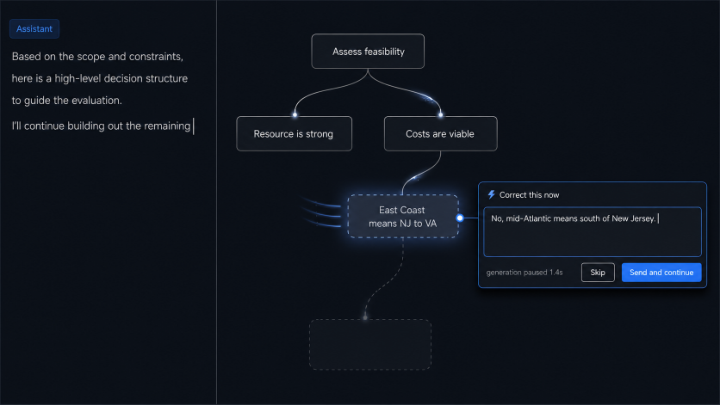](15%20Chat%20Interaction%20Techniques/) | **[15 Chat Interaction Techniques](15%20Chat%20Interaction%20Techniques/)**  Fifteen visualization and interaction techniques — [PDF](15%20Chat%20Interaction%20Techniques/v6_chat-interaction-techniques.pdf) · [DOCX](15%20Chat%20Interaction%20Techniques/v6_chat-interaction-techniques.docx) |
| [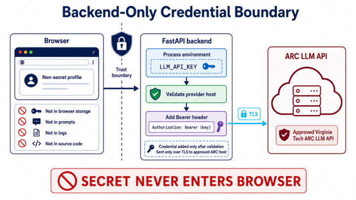](ARC%2C%20Chatbots%2C%20and%20Secrets%20Managment/) | **[ARC, Chatbots, and Secrets Managment](ARC%2C%20Chatbots%2C%20and%20Secrets%20Managment/)**  Chatbox on ARC: technical plan and software design — [PDF](ARC%2C%20Chatbots%2C%20and%20Secrets%20Managment/v1%20chatbox-arc-design.pdf) · [DOCX](ARC%2C%20Chatbots%2C%20and%20Secrets%20Managment/v1%20chatbox-arc-design.docx)  Secrets and keys management whitepaper — [PDF](ARC%2C%20Chatbots%2C%20and%20Secrets%20Managment/secrets-and-keys-management-whitepaper.pdf) · [DOCX](ARC%2C%20Chatbots%2C%20and%20Secrets%20Managment/secrets-and-keys-management-whitepaper.docx) · [Markdown](ARC%2C%20Chatbots%2C%20and%20Secrets%20Managment/secrets-and-keys-management-whitepaper.md)  Secrets and keys management reference — [PDF](ARC%2C%20Chatbots%2C%20and%20Secrets%20Managment/secrets-and-keys-management.pdf) · [Markdown](ARC%2C%20Chatbots%2C%20and%20Secrets%20Managment/secrets-and-keys-management.md) |
| [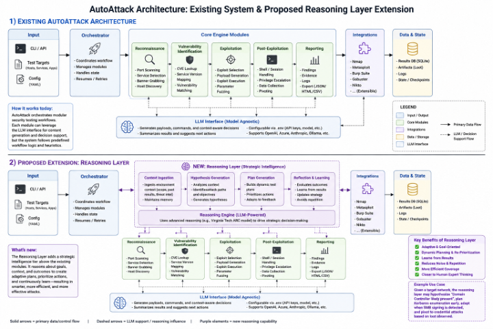](AutoAttacker%20Initial%20Project%20Concept/) | **[AutoAttacker Initial Project Concept](AutoAttacker%20Initial%20Project%20Concept/)**  Extending AUTOATTACKER with evidence-grounded strategic reasoning — [PDF](AutoAttacker%20Initial%20Project%20Concept/AUTOATTACKER_Evidence_Grounded_Reasoning_Extension.pdf) · [DOCX](AutoAttacker%20Initial%20Project%20Concept/AUTOATTACKER_Evidence_Grounded_Reasoning_Extension.docx)  [AutoAttacker Project Extension (PNG)](AutoAttacker%20Initial%20Project%20Concept/AutoAttacker%20Project%20Extension.png) |
| [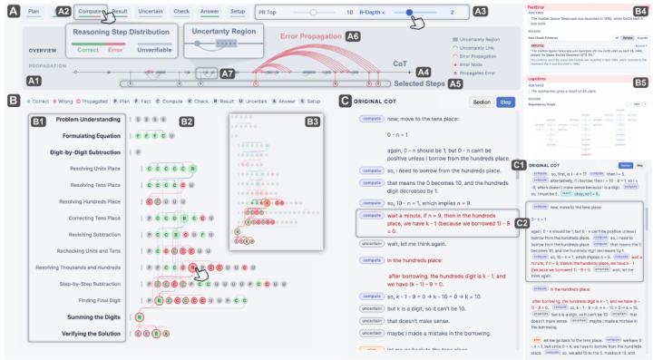](CoT%2C%20Visualization%2C%20and%20Human%20Interaction%20-%20Literature%20Review/) | **[CoT, Visualization, and Human Interaction - Literature Review](CoT%2C%20Visualization%2C%20and%20Human%20Interaction%20-%20Literature%20Review/)**  LLM reasoning, visualization, and human interaction: review of 33 papers — [PDF](CoT%2C%20Visualization%2C%20and%20Human%20Interaction%20-%20Literature%20Review/v1%20cot-visualization-literature-review-whitepaper.pdf) · [DOCX](CoT%2C%20Visualization%2C%20and%20Human%20Interaction%20-%20Literature%20Review/v1%20cot-visualization-literature-review-whitepaper.docx) · [Markdown](CoT%2C%20Visualization%2C%20and%20Human%20Interaction%20-%20Literature%20Review/v1%20cot-visualization-literature-review-whitepaper.md) |
| [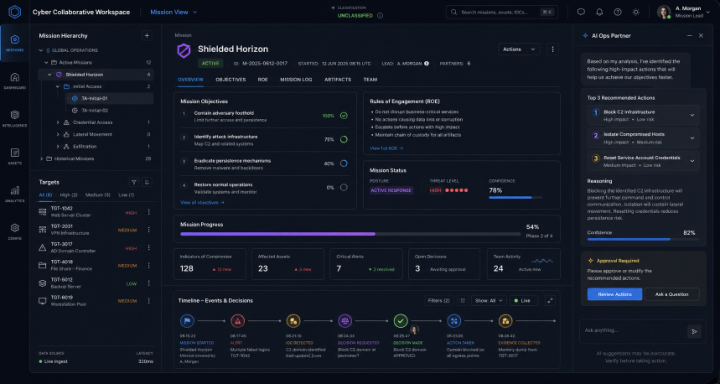](Cyber%20Space%20to%20Work/) | **[Cyber Space to Work](Cyber%20Space%20to%20Work/)**  Space to Work: a shared cognitive workspace for human-AI cyber operations — [PDF](Cyber%20Space%20to%20Work/Cyber%20Space%20to%20Work%20v1.pdf) · [DOCX](Cyber%20Space%20to%20Work/Cyber%20Space%20to%20Work%20v1.docx) |
| [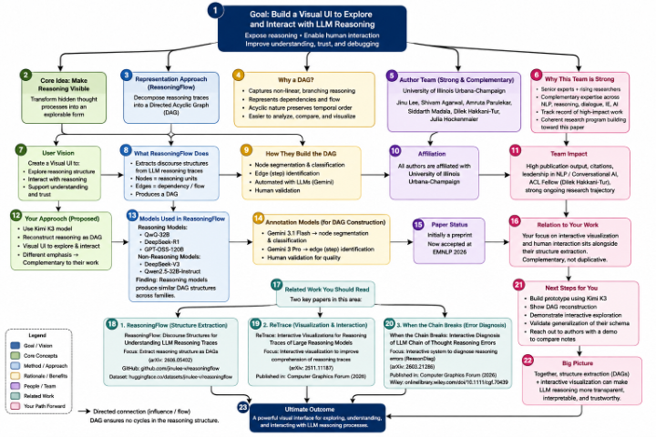](Directed%20Acyclical%20Graphs%20of%20Thought%20Cards/) | **[Directed Acyclical Graphs of Thought Cards](Directed%20Acyclical%20Graphs%20of%20Thought%20Cards/)**  From serialized reasoning traces to interactive reasoning graphs — [PDF](Directed%20Acyclical%20Graphs%20of%20Thought%20Cards/Interactive_Reasoning_Graphs_for_Kimi_K3_Whitepaper.pdf) · [DOCX](Directed%20Acyclical%20Graphs%20of%20Thought%20Cards/Interactive_Reasoning_Graphs_for_Kimi_K3_Whitepaper.docx) · [Markdown](Directed%20Acyclical%20Graphs%20of%20Thought%20Cards/Interactive_Reasoning_Graphs_for_Kimi_K3_Whitepaper.md) |
| [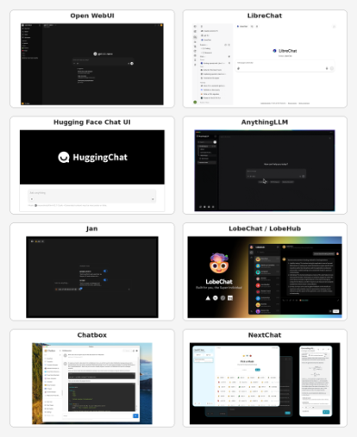](Evaluation%20of%20OpenSource%20Chatbots/) | **[Evaluation of OpenSource Chatbots](Evaluation%20of%20OpenSource%20Chatbots/)**  Selecting an OpenAI-compatible open-source or source-available chat client — [PDF](Evaluation%20of%20OpenSource%20Chatbots/v8_openai_compatible_chat_clients_acm_refs.pdf) · [DOCX](Evaluation%20of%20OpenSource%20Chatbots/v8_openai_compatible_chat_clients_acm_refs.docx) |
| [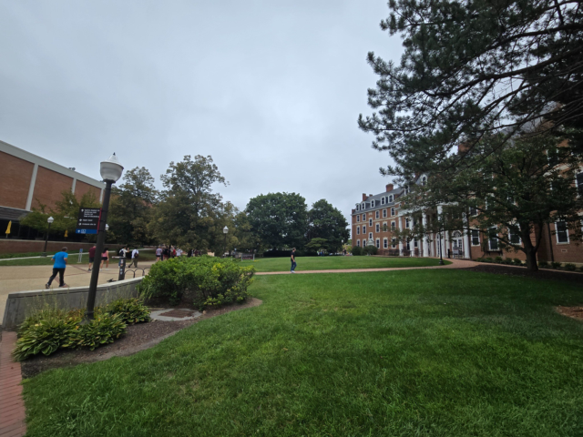](Graduate%20School%20Orientation/) | **[Graduate School Orientation](Graduate%20School%20Orientation/)**  Virginia Tech graduate school orientation, 2026 — [PDF](Graduate%20School%20Orientation/Virginia-Tech-Graduate-School-Orientation-2026-Whitepaper-2.pdf) |
| [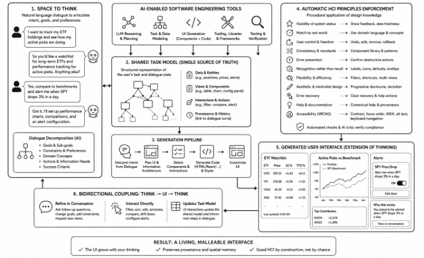](How%20to%20Science%20-%20Running%20an%20Agentic%20Study/) | **[How to Science - Running an Agentic Study](How%20to%20Science%20-%20Running%20an%20Agentic%20Study/)**  Evaluating machine-readable HCI Skills for LLM-generated user interfaces — [PDF](How%20to%20Science%20-%20Running%20an%20Agentic%20Study/agentic-study-of-skills.pdf) · [DOCX](How%20to%20Science%20-%20Running%20an%20Agentic%20Study/agentic-study-of-skills.docx)  Automating the application of HCI principles — [PDF](How%20to%20Science%20-%20Running%20an%20Agentic%20Study/Automating_the_Application_of_HCI_Principles___v_2026_07_11.pdf)  Can LLMs improve accessibility? — [PDF](How%20to%20Science%20-%20Running%20an%20Agentic%20Study/Can%20LLMs%20Improve%20Accessibility_.pdf) |
| [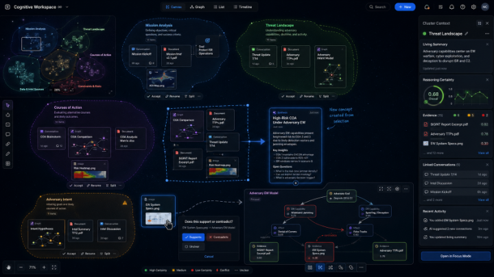](Interactive%20CoT%20Visualization%20%2B%20Cognitive%20Copilot/) | **[Interactive CoT Visualization + Cognitive Copilot](Interactive%20CoT%20Visualization%20%2B%20Cognitive%20Copilot/)**  Interactive visual chain-of-thought: collaborative reasoning workspaces — [PDF](Interactive%20CoT%20Visualization%20%2B%20Cognitive%20Copilot/v5%20Interactive%20Visual%20Chain%20of%20Thought%20styled.pdf) · [DOCX](Interactive%20CoT%20Visualization%20%2B%20Cognitive%20Copilot/v5%20Interactive%20Visual%20Chain%20of%20Thought%20styled.docx) |
| [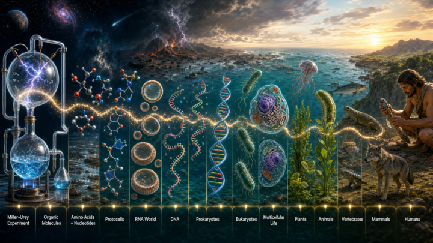](Philosophy%2C%20Meaning%2C%20and%20AI/) | **[Philosophy, Meaning, and AI](Philosophy%2C%20Meaning%2C%20and%20AI/)**  Evolution, intelligence, meaning, and artificial intelligence — [PDF](Philosophy%2C%20Meaning%2C%20and%20AI/Evolution_Intelligence_Meaning_and_AI_Whitepaper.pdf) · [DOCX](Philosophy%2C%20Meaning%2C%20and%20AI/Evolution_Intelligence_Meaning_and_AI_Whitepaper.docx) |
| [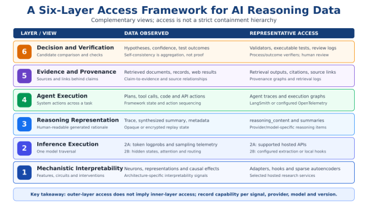](Reasoning%20Model%20Access%20Layers/) | **[Reasoning Model Access Layers](Reasoning%20Model%20Access%20Layers/)**  A layered framework for accessing AI reasoning data — [PDF](Reasoning%20Model%20Access%20Layers/v6_reasoning-access-layers.pdf) · [DOCX](Reasoning%20Model%20Access%20Layers/v6_reasoning-access-layers.docx) |
| [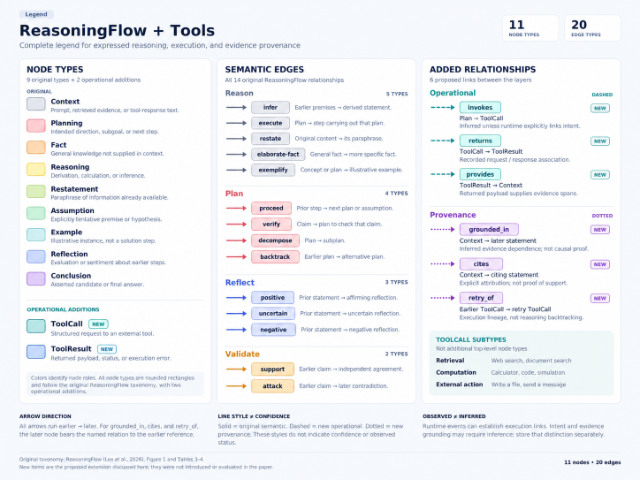](ReasoningFlow%20with%20Tool%20Call%20and%20Web%20Search/) | **[ReasoningFlow with Tool Call and Web Search](ReasoningFlow%20with%20Tool%20Call%20and%20Web%20Search/)**  ReasoningFlow: original paper — [PDF](ReasoningFlow%20with%20Tool%20Call%20and%20Web%20Search/ReasoningFlow%202606.05402v1.pdf)  Tool calls and web search: incremental annotation design — [PDF](ReasoningFlow%20with%20Tool%20Call%20and%20Web%20Search/ReasoningFlowWithToolCall.pdf) · [DOCX](ReasoningFlow%20with%20Tool%20Call%20and%20Web%20Search/ReasoningFlowWithToolCall.docx)  Streaming graph design and developer specification (long version) — [PDF](ReasoningFlow%20with%20Tool%20Call%20and%20Web%20Search/ReasoningFlowWithToolCall%20Long.pdf) · [DOCX](ReasoningFlow%20with%20Tool%20Call%20and%20Web%20Search/ReasoningFlowWithToolCall%20Long.docx)  Tool calls and web search: annotation guide — [PDF](ReasoningFlow%20with%20Tool%20Call%20and%20Web%20Search/ReasoningFlowWithToolCall%20AnnotationGuide.pdf) · [DOCX](ReasoningFlow%20with%20Tool%20Call%20and%20Web%20Search/ReasoningFlowWithToolCall%20AnnotationGuide.docx) |
| [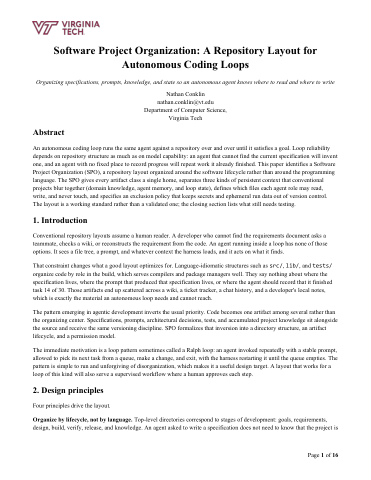](Software%20Project%20Layout%20-%20project-layout.md/) | **[Software Project Layout - project-layout.md](Software%20Project%20Layout%20-%20project-layout.md/)**  Software project organization: a repository layout for autonomous coding loops — [PDF](Software%20Project%20Layout%20-%20project-layout.md/project-layout.pdf) · [DOCX](Software%20Project%20Layout%20-%20project-layout.md/project-layout.docx) · [Markdown](Software%20Project%20Layout%20-%20project-layout.md/project-layout.md) |
| [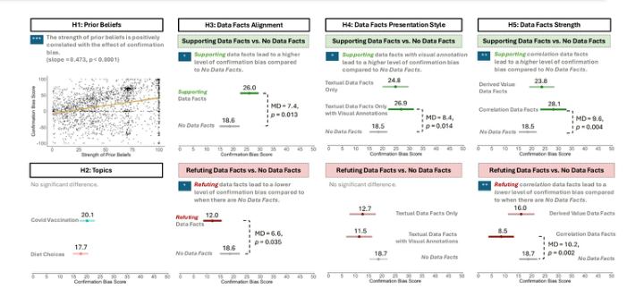](VIS%20SEA%202026%20Notes%20on%20How%20to%20Present%20and%20Write%20Technical%20Papers/) | **[VIS SEA 2026 Notes on How to Present and Write Technical Papers](VIS%20SEA%202026%20Notes%20on%20How%20to%20Present%20and%20Write%20Technical%20Papers/)**  Write Generously: audience-centered practice for research talks and papers — [PDF](VIS%20SEA%202026%20Notes%20on%20How%20to%20Present%20and%20Write%20Technical%20Papers/write-generously.pdf) · [DOCX](VIS%20SEA%202026%20Notes%20on%20How%20to%20Present%20and%20Write%20Technical%20Papers/write-generously.docx)  [Example diagram (JPG)](VIS%20SEA%202026%20Notes%20on%20How%20to%20Present%20and%20Write%20Technical%20Papers/Example%20diagram.jpg) |
| [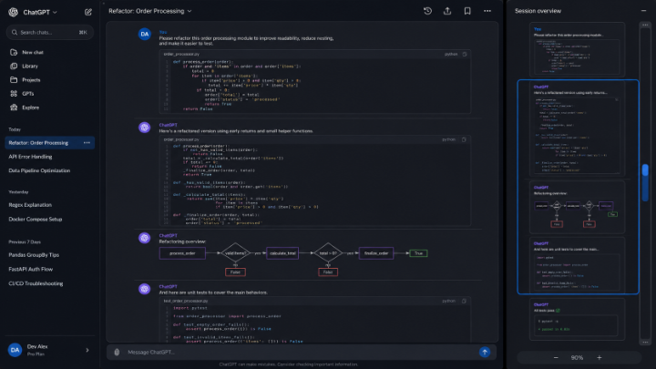](Visual%20Scrollbars/) | **[Visual Scrollbars](Visual%20Scrollbars/)**  Overview-and-detail visual scrollbar for long AI chats — [PDF](Visual%20Scrollbars/overview-detail-visual-scrollbar-whitepaper.pdf) · [DOCX](Visual%20Scrollbars/overview-detail-visual-scrollbar-whitepaper.docx) |
| [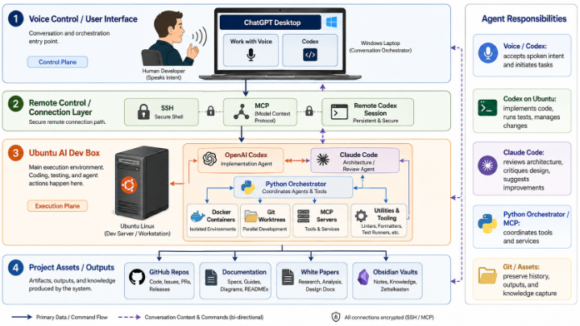](Voice%20Controlled%20Agents/) | **[Voice Controlled Agents](Voice%20Controlled%20Agents/)**  Voice-controlled agentic development: control-plane/execution-plane architecture — [PDF](Voice%20Controlled%20Agents/Voice_Controlled_Agentic_Development_Whitepaper.pdf) · [DOCX](Voice%20Controlled%20Agents/Voice_Controlled_Agentic_Development_Whitepaper.docx)  Voice-driven AI orchestration: a human-agent operating layer — [PDF](Voice%20Controlled%20Agents/Voice_Driven_AI_Orchestration_Whitepaper.pdf) · [DOCX](Voice%20Controlled%20Agents/Voice_Driven_AI_Orchestration_Whitepaper.docx) |

Thumbnail sources are recorded in [`thumbs/sources.json`](thumbs/sources.json).

## License

MIT — see [LICENSE](LICENSE).
