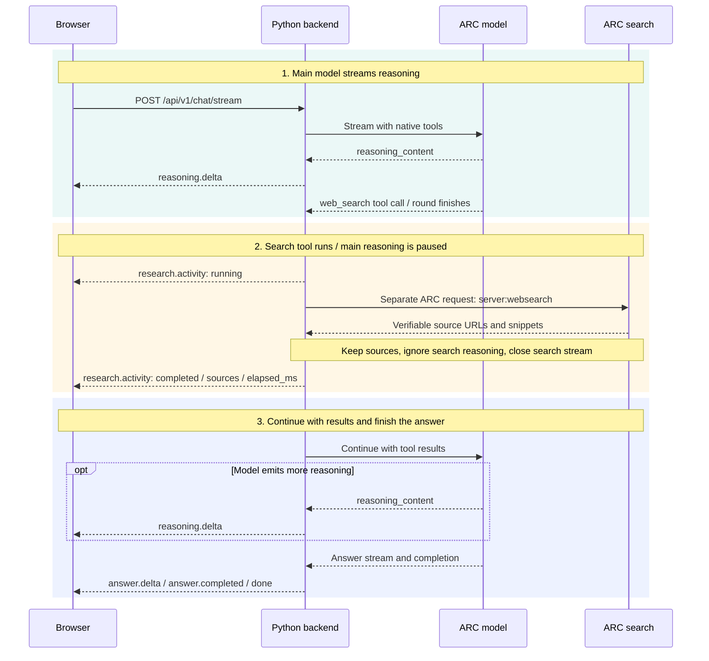

# Why reasoning pauses during web search

The browser maintains one streaming chat request while the Python backend alternates between model generation and tool execution. This diagram shows one successful web-search cycle; additional tool calls run sequentially before the next model continuation.

- [JPG diagram](websearch-sequence.jpg)
- [Editable PowerPoint diagram (.ppt)](websearch-sequence.ppt)

## What each participant does

| Participant | Responsibility |
| --- | --- |
| Browser | Sends the chat request and displays answer, reasoning, and research activity events. |
| Python backend | Collects tool calls, executes them sequentially, forwards observable activity, and sends tool results back to the model. |
| ARC model | Generates the main response and requests tools. Its model round finishes before those tools execute. |
| ARC search | Represents the separate request enabling ARC's server-side web search. It is a logical participant, not a claim about ARC's internal service architecture. |

## What is visible during the pause

- Open the active turn's **Thought** tab and expand **Research activity** to see the tool, query, status, and returned source links.
- `research.activity` reports tool start and completion or failure. `elapsed_ms` is populated at completion or failure; it is not a live counter.
- The separate search adapter consumes source frames. It does not forward its generated answer or reasoning to the browser, and closes its upstream stream as soon as usable sources arrive.
- Main-model reasoning resumes only if the continuation emits more reasoning. The browser receives normalized `reasoning.delta` events rather than the upstream field name `reasoning_content`.
- The UI text **Reasoning data being received** depends on whether any reasoning has accumulated. It does not indicate when the latest reasoning fragment arrived.

This is the successful web-search path. Failure and cancellation branches, optional page reads, document tools, and Python analysis are omitted for clarity. Multiple tools execute sequentially. Arrow spacing does not represent elapsed time.

## Implementation references

- [Browser streaming request and event handling](../../src/web/src/streaming.ts)
- [Backend streaming route and event normalization](../../src/api/routes/chat.py)
- [Research orchestration and tool-result continuation](../../src/services/research_loop.py)
- [ARC search adapter and tool dispatch](../../src/services/research_tools.py)
- [Research activity display](../../src/web/src/research.tsx)
- [Waiting message and accumulated reasoning](../../src/web/src/App.tsx)
- [Application-owned research tools decision](../decisions/ADR-018-research-tools.md)
